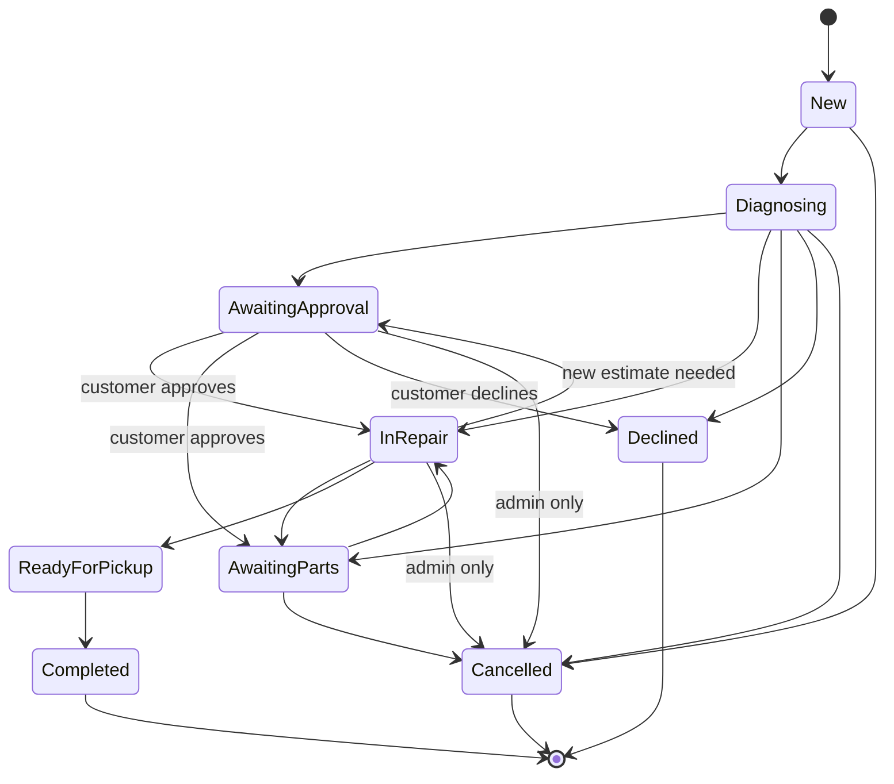
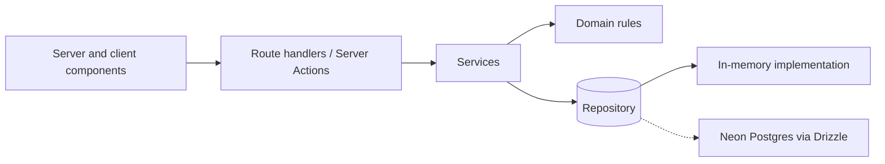

# Tech Repair

A web portal for a small electronics repair shop. Customers open repair tickets and follow their progress; the shop team diagnoses devices, records estimates and keeps tickets up to date.

> **Status: early development.** Only the project scaffold, the UI base, the ticket domain rules, an in-memory data layer, a mock sign-in and the customer screens exist so far. Everything under [Planned features](#planned-features) is a goal, not something you can use yet. See [Roadmap](#roadmap).

## Planned features

**Customers**

- Sign up, sign in and recover a password
- Open a repair ticket (device type, brand, model, problem description)
- Follow a ticket: status, diagnosis, estimate, expected completion date and history
- Chat with the shop team
- Approve or decline an estimate (declining requires a reason)

**Shop team**

- Dashboard with ticket counts per status and a searchable, filterable ticket list
- Record diagnosis, estimates and expected completion dates
- Assign technicians and update priority and status
- Send messages to the customer and keep internal notes, kept visibly separate

## Roles

| Role       | Access                                                            |
| ---------- | ----------------------------------------------------------------- |
| Customer   | Own tickets only. Public sign-up always creates this role.        |
| Technician | Tickets assigned to them. Cannot manage users or global settings. |
| Admin      | Everything: all tickets, technician assignment, user management.  |

Permissions are enforced on the server for every read and write, not only by hiding buttons. Internal notes are never returned to customers.

## Ticket status flow



Transitions are business rules validated on the server. Completed, Declined and Cancelled are final.

Staff (the assigned technician or an admin) make the status changes, except that only the customer approves or declines an estimate, and only an admin cancels from Awaiting approval or In repair. Customers cannot cancel. Asking for approval needs a pending estimate, and changing the amount of an estimate sends a ticket in repair back to Awaiting approval. The rules live in `src/domain/ticket`.

## Architecture



- **Domain** holds pure, tested business rules: status transitions, permissions, estimate approval.
- **Services** orchestrate use cases and run authorization checks.
- **Repository** is an interface. The first implementation is in memory so the product can be built end to end; the Neon Postgres + Drizzle implementation (dashed) replaces it last, without touching the layers above. The interface and the in-memory version live in `src/server/repository`, and `getRepository()` returns one shared instance filled with demo data (all users and emails are made up).
- Input is validated with Zod on the server, with field-level error messages.

## Stack

- Next.js (App Router) and TypeScript (strict)
- Tailwind CSS v4, with shadcn/ui as an accessibility base
- Zod for validation
- Vitest and Testing Library
- Planned: Neon Postgres, Drizzle ORM, an authentication library (to be chosen against current docs), deployment on Vercel

## Getting started

Requires Node 20.9 or newer (see `.nvmrc`).

```bash
npm install
npm run dev
```

Open http://localhost:3000. You are sent to the sign-in page, where one demo account per role (customer, technician and admin) signs in with a single click. While authentication is a mock, any password works.

Signed in as the demo customer, you can see your repairs, send a new repair request, message the shop and approve or decline an estimate. Approving sends the ticket to In repair; declining needs a reason and closes the ticket. The technician and admin accounts only see a welcome page until the shop team screens exist.

## Design system

Tokens (color, radius, shadow, status tones) live in `src/app/globals.css`; the shadcn/ui components in `src/components/ui` consume them. The light and dark themes follow the saved choice or the system preference, and a script in the root layout applies it before first paint. Status tones always pair a color with a text label. Browse every component at `/ui-kit`.

## Scripts

| Script                 | Description                    |
| ---------------------- | ------------------------------ |
| `npm run dev`          | Start the dev server           |
| `npm run build`        | Production build               |
| `npm run typecheck`    | Type-check with `tsc --noEmit` |
| `npm run lint`         | Run ESLint                     |
| `npm test`             | Run tests in watch mode        |
| `npm run test:run`     | Run tests once                 |
| `npm run format`       | Format the code with Prettier  |
| `npm run format:check` | Check formatting with Prettier |

## Conventions

- Imports use the `@/` alias; relative parent imports (`../`) are blocked by ESLint.
- Tests live next to the code they cover (`x.ts` and `x.test.ts`).
- Conventional Commits, one branch per feature, merged through pull requests.

## Roadmap

- [x] Project setup: Next.js, Tailwind, Vitest, lint rules
- [x] Design tokens and UI base (light and dark themes, responsive layout)
- [x] Ticket domain: status machine, permissions, estimate rules
- [x] In-memory repository and demo seed data
- [x] Mock authentication with the three roles
- [x] Customer screens
- [ ] Shop team screens
- [ ] Real database (Neon + Drizzle migrations) and real authentication
- [ ] Vercel deployment guide and first-admin setup

## Out of scope for v1

Online payments, inventory and parts purchasing, WhatsApp/SMS/email notifications, multiple shops, native apps, photo upload (needs real storage) and advanced financial reports.

## Production notes

While the in-memory repository is in use, data lives in the server process: it resets on restart and is not shared between instances, so it is for development and demos only. Production data will live in Neon Postgres.

The sign-in is a mock too: any password is accepted, and the session cookie holds the bare user id without a signature, so anyone can forge it. It must be replaced by real authentication before the app is exposed to real users.
